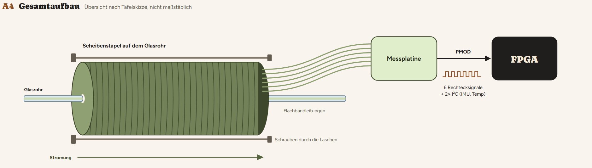
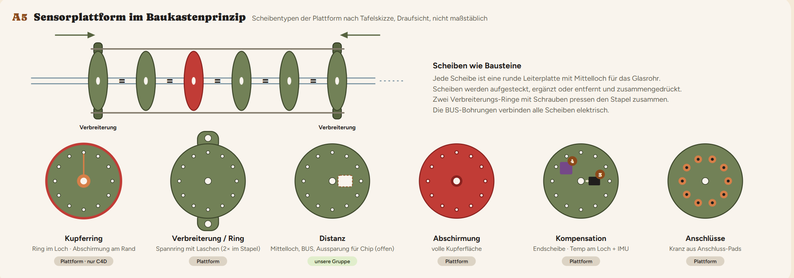
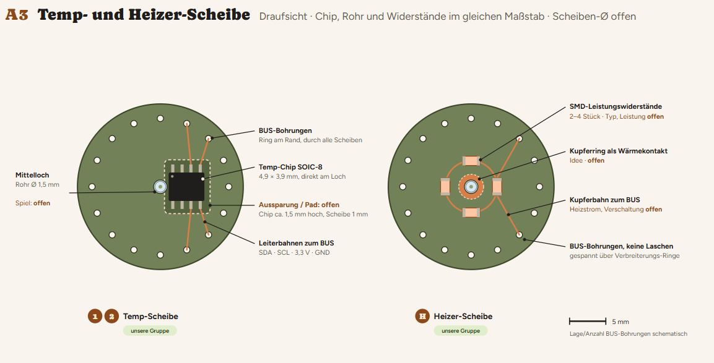

# Intelligente Messsysteme: Thermischer Durchflusssensor

Gruppenprojekt für VA4 Intelligente Messsysteme (HTW Berlin, 2. Semester).

Wir entwickeln das **thermische Messmodul** für eine modulare Sensorplattform: ein Durchflussmesser für 50 bis 200 ml/h in einer Glaskapillare (0,5 mm Innendurchmesser, 1,5 mm Außendurchmesser). Die Plattform besteht aus stapelbaren runden PCB-Scheiben. Der C4D-Sensor und der optische Sensor werden von anderen Gruppen gebaut, alles läuft im FPGA zusammen.

## Projektidee

- **Ziel:** Den Durchfluss in einer dünnen Glaskapillare messen, auch ohne Luftblasen im Wasser.
- **Prinzip:** Ein Heizer erwärmt das Wasser leicht (ca. 1 K). Ein Temperatursensor vor und einer nach dem Heizer messen die Temperatur außen am Rohr. Aus der Temperaturdifferenz folgt der Durchfluss, abgeglichen mit einer Waage.
- **Aufbau:** Ein Stapel runder Leiterplatten-Scheiben auf dem Rohr. Die Sensoren sitzen außen auf den Endscheiben, in der Mitte sitzt der Heizer (Widerstandsdraht oder Via).
- **Sensoren:** Digitale Temperatursensoren über I²C (TMP1075 oder MCP9808) und eine IMU (MPU-6050) für Erschütterungen.
- **Stand:** Entwurf. Viele Punkte sind noch offen, siehe Lastenheft.

## Skizzen

Alle Skizzen sind Entwürfe und nicht maßstäblich. Details sind noch offen.

**Gesamtaufbau:** Scheibenstapel auf dem Glasrohr, Flachbandleitungen zur Messplatine, PMOD zum FPGA.

**Scheiben im Baukastenprinzip:** Die Scheibentypen der Plattform nach der Tafelskizze.

**Temp- und Heizer-Scheibe:** Unsere Scheiben für das thermische Modul.

## Gruppe

- Alaa Daaboul
- Bryan Sahetapy
- Ezatullah Khalili

## Ordnerstruktur

| Ordner | Inhalt |
|---|---|
| `docs/` | Lastenheft, Zusammenfassungen, Präsentationen (am besten als PDF), Skizzen in `docs/abbildungen/` |
| `3D/` | 3D .STL / .STEP Datei |
| `hardware/` | Schaltpläne, PCB-Exporte (PDF, Gerber), Stückliste |
| `measurements/` | Messdaten, Fotos, Diagramme |
| `research/` | Notizen zu Sensoren, ADC, Heizer und thermischen Durchflussmessern in der Industrie |

## Arbeitsregeln

- Vor dem Push immer zuerst pullen.
- Änderungen an `main` nur über einen Pull Request.
- Commit-Nachrichten kurz und klar halten.
- Die PCBs werden in Fusion (Cloud) entworfen. Committet werden die **Exporte**, nicht die Cloud-Dateien.
- PDF statt Word-Dateien verwenden, weil Git Word-Dateien nicht vergleichen kann.
- Dieses Repository ist öffentlich. Keine persönlichen Daten (zum Beispiel Matrikelnummern) und kein Material vom Dozenten ohne Rückfrage hochladen.
