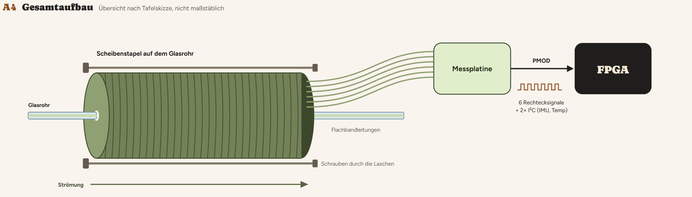
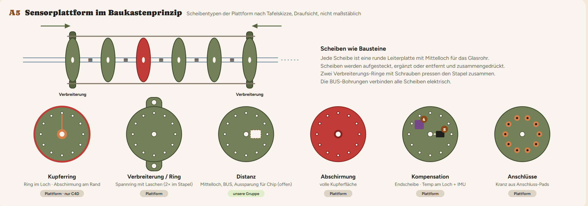
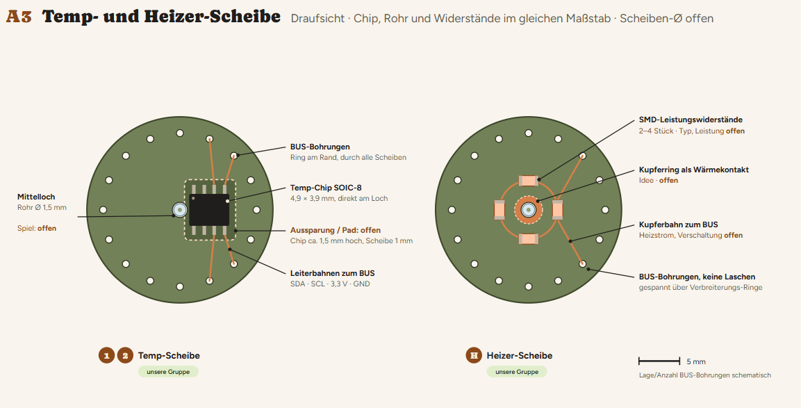
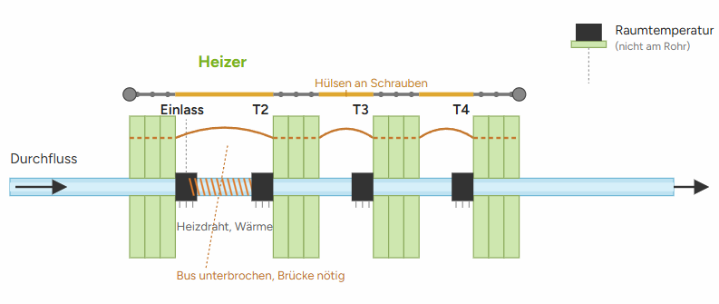

# Intelligente Messsysteme: Thermischer Durchflusssensor

Gruppenprojekt für VA4 Intelligente Messsysteme (HTW Berlin, 2. Semester).

Wir entwickeln das **thermische Messmodul** für eine modulare Sensorplattform: ein Durchflussmesser für 50 bis 200 ml/h in einer Glaskapillare (0,5 mm Innendurchmesser, 1,5 mm Außendurchmesser). Die Plattform besteht aus stapelbaren runden PCB-Scheiben. Der C4D-Sensor und der optische Sensor werden von anderen Gruppen gebaut, alles läuft im FPGA zusammen.

## Projektidee

- **Ziel:** Den Durchfluss in einer dünnen Glaskapillare messen, auch ohne Luftblasen im Wasser.
- **Prinzip:** Ein Heizer erwärmt das Wasser leicht (ca. 1 K). Ein Temperatursensor vor und einer nach dem Heizer messen die Temperatur außen am Rohr. Aus der Temperaturdifferenz folgt der Durchfluss, abgeglichen mit einer Waage.
- **Aufbau:** Ein Stapel runder Leiterplatten-Scheiben auf dem Rohr. Die Sensoren sitzen außen auf den Endscheiben, in der Mitte sitzt der Heizer (Widerstandsdraht).
- **Sensoren:** NTC-Thermistoren in einem Schmitt-Trigger-Oszillator (**SN74LVC2G14**). Die Frequenz des Rechtecksignals folgt der Temperatur, das FPGA zählt sie. Keine digitalen I²C-Temperatursensoren und kein ADC. Eine IMU ist nicht nötig, weil Erschütterungen die Temperaturmessung nicht beeinflussen.
- **Stand:** Entwurf. Viele Punkte sind noch offen, siehe Lastenheft.

## Skizzen

Alle Skizzen sind Entwürfe und nicht maßstäblich. Details sind noch offen.

**Gesamtaufbau:** Scheibenstapel auf dem Glasrohr, Flachbandleitungen zur Messplatine, PMOD zum FPGA.

**Scheiben im Baukastenprinzip:** Die Scheibentypen der Plattform nach der Tafelskizze.

**Temp- und Heizer-Scheibe:** Unsere Scheiben für das thermische Modul.

**Sensoranordnung:** Scheibenblöcke mit Lücken am Rohr.

## Heizer

**Aufgabe:** Ohne Heizer gibt es keinen Messeffekt, weil das Wasser überall die gleiche Temperatur hat. Der Heizer erzeugt die Temperaturdifferenz, die der Sensor messen kann.

**So funktioniert es:**
- Der Heizer gibt eine kleine, bekannte Wärmemenge an das Wasser ab (ca. 0,25 W, ca. 1 K Erwärmung bei 200 ml/h).
- Das fließende Wasser trägt die Wärme zum zweiten Sensor.
- Der Sensor vor dem Heizer misst die normale Wassertemperatur, der Sensor nach dem Heizer das erwärmte Wasser.
- Die Temperaturdifferenz der beiden Sensoren zeigt den Durchfluss.

**Abhängigkeit vom Durchfluss:**
- Langsamer Fluss: Das Wasser bleibt lange am Heizer und wird wärmer, die Differenz ist groß (ca. 4 K bei 50 ml/h).
- Schneller Fluss: Das Wasser fließt schnell vorbei und die Wärme verteilt sich auf mehr Wasser, die Differenz ist klein (ca. 1 K bei 200 ml/h).
- Ohne Durchfluss bleibt die Wärme am Heizer und breitet sich in beide Richtungen aus.

**Ausführung:** Lackierter Widerstandsdraht, eng auf die Glaskapillare gewickelt. Eine Via scheidet aus, weil Kupfer zu wenig Widerstand hat.

| Größe | Wert |
|---|---|
| Versorgung | 3,3 V |
| Ziel-Leistung | 0,25 W |
| Widerstand | ca. 44 Ω (P = U² / R), Strom ca. 76 mA |
| Draht | lackiert, z. B. Konstantan oder Nichrom 0,05 mm; Länge aus Ω/m des Datenblatts berechnen, etwas länger schneiden und mit dem Multimeter kürzen |
| Schalten | über MOSFET, nicht direkt vom Pin |

**Einbau:**
1. Dünne Schicht nicht leitende Wärmeleitpaste (Silikon oder Keramik, kein Metall) auf das Glas.
2. Draht eng hineinwickeln.
3. Dünne Schicht Paste über die Wicklung.
4. Drahtenden mit 2-Komponenten-Epoxid oder Kaptonband fixieren. Die Paste hält den Draht nicht.

Paste nur im Heizerbereich auftragen, damit keine Wärme zu den Sensoren wandert. Kein Heißkleber, er wird bei ca. 100 °C weich.

**Wichtig:** Den Heizer nie ohne Durchfluss oder bei trockenem Rohr einschalten, sonst wird er zu heiß.

**Offen:** Kann die 3,3-V-Versorgung dauerhaft ca. 80 mA für den Heizer liefern?

## Temperaturmessung: NTC und Schmitt-Trigger

**Prinzip:** Ein NTC-Thermistor (sein Widerstand sinkt mit steigender Temperatur) bestimmt als Widerstand die Frequenz eines Schmitt-Trigger-Oszillators. Die Temperatur steckt damit in der Frequenz des Rechtecksignals. Das FPGA zählt die Flanken über den PMOD-Anschluss. Dafür braucht es weder einen ADC noch I²C-Temperatursensoren.

**Funktionsweise:**
- Der Ausgang Y des Inverters geht über den Widerstand (später der NTC) zurück auf den Eingang A. Ein Kondensator liegt zwischen A und GND.
- Der Kondensator lädt und entlädt sich über den Widerstand. Der Chip kippt an seinen zwei Schwellen und erzeugt so ein Rechtecksignal.
- Die Frequenz hängt von Widerstand und Kondensator ab (f ≈ k / (R · C)). Ändert sich der NTC-Widerstand, ändert sich die Frequenz.
- Der Chip enthält zwei Inverter: Der erste ist der Oszillator, der zweite dahinter dient als Puffer, damit das Signal sauber bleibt und Leitung und FPGA den Oszillator nicht belasten.

| Größe | Wert |
|---|---|
| Bauteil | SN74LVC2G14 (Texas Instruments), doppelter Schmitt-Trigger-Inverter (Oszillator und Puffer in einem Gehäuse) |
| Datenblatt | [`docs/datasheets/SN74LVC2G14_Doppel-Schmitt-Trigger_Datenblatt.pdf`](docs/datasheets/SN74LVC2G14_Doppel-Schmitt-Trigger_Datenblatt.pdf) |
| Versorgung | 3,3 V, dazu 100 nF und 1 µF parallel direkt am VCC-Pin |
| Gehäuse | SOT-23 mit 6 Pins (DBV): Pin 1 1A (Eingang Oszillator), 2 GND, 3 2A (Eingang Puffer), 4 2Y (Ausgang Puffer), 5 VCC, 6 1Y (Ausgang Oszillator) |
| Schwellen bei 3 V | VT+ 1,3 bis 2,2 V, VT− 0,6 bis 1,3 V (Datenblatt, großer Streubereich, jeder Kanal wird kalibriert) |
| Frequenz | unter 20 MHz (Grenze des Projekts) |
| NTC | 10 kΩ, Typ und Gehäuse (SMD 0603 oder Glasperle) noch offen |
| Kanäle | 6, je ein Chip pro Sensor |
| Widerstände und Kondensatoren | Bauform 0805 |

**Kalibrierung:** Die Zuordnung von Frequenz zu Temperatur wird bei bekannten Temperaturen gemessen und danach im FPGA per Software angewendet.

**Offen:** NTC-Typ, Konstante k der Frequenzformel (aus dem Datenblatt oder durch Messung), Wert des Kondensators, ob ein Filterkondensator nötig ist.

## Gruppe

- Alaa Daaboul
- Bryan Sahetapy
- Ezatullah Khalili

## Ordnerstruktur

| Ordner | Inhalt |
|---|---|
| `docs/` | Lastenheft, Zusammenfassungen, Präsentationen (am besten als PDF), Skizzen in `docs/abbildungen/`, Datenblätter in `docs/datasheets/` |
| `3D/` | 3D .STL / .STEP Datei |
| `hardware/` | Schaltpläne, PCB-Exporte (PDF, Gerber), Stückliste |
| `measurements/` | Messdaten, Fotos, Diagramme |
| `research/` | Notizen zu Sensoren, Heizer und thermischen Durchflussmessern in der Industrie |

## Arbeitsregeln

- Vor dem Push immer zuerst pullen.
- Änderungen an `main` nur über einen Pull Request.
- Commit-Nachrichten kurz und klar halten.
- Die PCBs werden in Fusion (Cloud) entworfen. Committet werden die **Exporte**, nicht die Cloud-Dateien.
- PDF statt Word-Dateien verwenden, weil Git Word-Dateien nicht vergleichen kann.
- Dieses Repository ist öffentlich. Keine persönlichen Daten (zum Beispiel Matrikelnummern) und kein Material vom Dozenten ohne Rückfrage hochladen.
