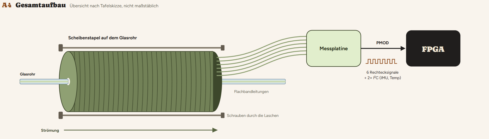
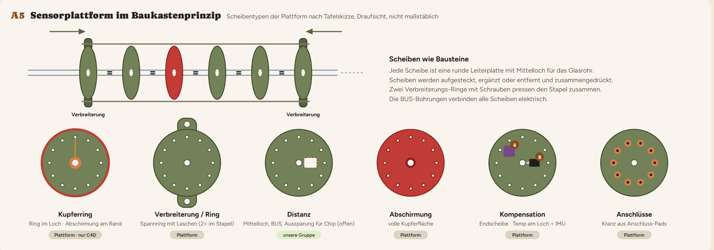
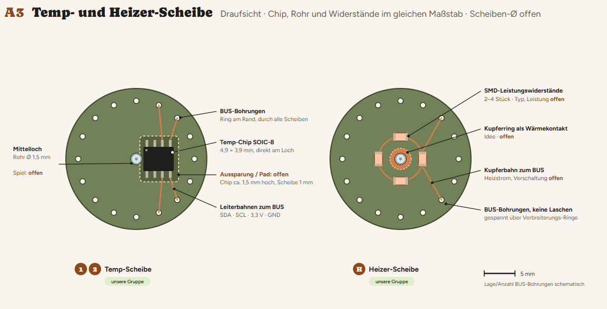

# Intelligente Messsysteme: Thermischer Durchflusssensor

Gruppenprojekt für VA4 Intelligente Messsysteme (HTW Berlin, 2. Semester).

Wir entwickeln das **thermische Messmodul** für eine modulare Sensorplattform: ein Durchflussmesser für 50 bis 200 ml/h in einer Glaskapillare (0,5 mm Innendurchmesser, 1,5 mm Außendurchmesser). Die Plattform besteht aus stapelbaren runden PCB-Scheiben. Der C4D-Sensor und der optische Sensor werden von anderen Gruppen gebaut, alles läuft im FPGA zusammen.

## Projektidee

- **Ziel:** Den Durchfluss in einer dünnen Glaskapillare messen, auch ohne Luftblasen im Wasser.
- **Prinzip:** Ein Heizer erwärmt das Wasser leicht (ca. 1 K). Ein Temperatursensor vor und einer nach dem Heizer messen die Temperatur außen am Rohr. Aus der Temperaturdifferenz folgt der Durchfluss, abgeglichen mit einer Waage.
- **Aufbau:** Ein Stapel runder Leiterplatten-Scheiben auf dem Rohr. Die Sensoren sitzen außen auf den Endscheiben, in der Mitte sitzt der Heizer (Widerstandsdraht).
- **Sensoren:** Digitale Temperatursensoren über I²C (**TMP1075**, Entscheidung 2026-10-29). Eine IMU ist nicht nötig, weil Erschütterungen die Temperaturmessung nicht beeinflussen.
- **Stand:** Entwurf. Viele Punkte sind noch offen, siehe Lastenheft.

## Skizzen

Alle Skizzen sind Entwürfe und nicht maßstäblich. Details sind noch offen.

**Gesamtaufbau:** Scheibenstapel auf dem Glasrohr, Flachbandleitungen zur Messplatine, PMOD zum FPGA.

**Scheiben im Baukastenprinzip:** Die Scheibentypen der Plattform nach der Tafelskizze.

**Temp- und Heizer-Scheibe:** Unsere Scheiben für das thermische Modul.

## Heizer

**Aufgabe:** Der Heizer erwärmt das Wasser leicht (ca. 1 K). Ohne Heizer gibt es keinen Messeffekt, weil das Wasser überall die gleiche Temperatur hat. Das Wasser trägt die Wärme zum zweiten Sensor, und die Temperaturdifferenz zeigt den Durchfluss.

**Ausführung:** Lackierter Widerstandsdraht, eng auf die Glaskapillare gewickelt. Eine Via scheidet aus, weil Kupfer zu wenig Widerstand hat.

| Größe | Wert |
|---|---|
| Versorgung | 3,3 V (Vorgabe Dozent) |
| Ziel-Leistung | 0,25 W |
| Widerstand | ca. 44 Ω (P = U² / R), Strom ca. 76 mA |
| Draht | lackiert, z. B. Konstantan oder Nichrom 0,05 mm; Länge aus Ω/m des Datenblatts berechnen, etwas länger schneiden und mit dem Multimeter kürzen |
| Schalten | über MOSFET, nicht direkt vom Pin |

**Einbau:**
1. Dünne Schicht nicht leitende Wärmeleitpaste (Silikon oder Keramik, kein Metall) auf das Glas.
2. Draht eng hineinwickeln.
3. Dünne Schicht Paste über die Wicklung.
4. Drahtenden mit 2-Komponenten-Epoxid oder Kaptonband fixieren. Die Paste hält den Draht nicht.

Paste nur im Heizerbereich auftragen, damit keine Wärme zu den Sensoren wandert. Kein Heißkleber, er wird bei ca. 100 °C weich.

**Wichtig:** Den Heizer nie ohne Durchfluss oder bei trockenem Rohr einschalten, sonst wird er zu heiß.

**Offen:** Kann die 3,3-V-Versorgung dauerhaft ca. 80 mA für den Heizer liefern?

## Sensorspezifikation: TMP1075

Ausgewählter Temperatursensor für alle thermischen Messkanäle (Entscheidung 2026-10-29, vor MCP9808 und TMP117 gewählt).

| Parameter | Wert |
|---|---|
| Hersteller | Texas Instruments |
| Interface | I²C |
| Versorgungsspannung | 1,7–5,5 V (passt zu unserer 3,3-V-Plattformversorgung) |
| Auflösung | 12 Bit, 0,0625 °C pro LSB |
| Genauigkeit | ±1 °C typ. (±2 °C max. über den vollen Bereich) |
| Wandlungszeit | ca. 27,5 ms |
| I²C-Adressierung | 3 Adresspins → bis zu 8 Geräte an einem Bus |
| Gehäuse | sehr klein (z. B. SOT-563), gut für die Scheiben geeignet |
| Preis | niedrig (günstigster der verglichenen Kandidaten) |

**Begründung:** Von den verglichenen Kandidaten (TMP1075, MCP9808, TMP117) bietet TMP1075 die geringste Genauigkeit und Auflösung, dafür aber bis zu 8 Adressen pro Bus (TMP117 nur 4), niedrigen Preis und ausreichend kleine Bauform für den Scheibenstapel. Da ca. 5 Temperaturkanäle + Referenz/Umgebung auf einem I²C-Bus Platz finden müssen, war die Adressanzahl ausschlaggebend gegenüber der höheren Präzision von MCP9808/TMP117.

**Zu prüfen / offen:** Ob ±1 °C (±2 °C worst case) Genauigkeit ausreicht, um eine Temperaturdifferenz von nur ca. 1 K entlang der Messstrecke aufzulösen — ggf. Kalibrierung der einzelnen Sensoren gegeneinander nötig, um den systematischen Offset-Fehler herauszurechnen (relative Messung zwischen Sensoren ist genauer als die absolute Genauigkeit).

## Gruppe

- Alaa Daaboul
- Bryan Sahetapy
- Ezatullah Khalili

## Ordnerstruktur

| Ordner | Inhalt |
|---|---|
| `docs/` | Lastenheft, Zusammenfassungen, Präsentationen (am besten als PDF), Skizzen in `docs/abbildungen/` |
| `3D/` | 3D .STL / .STEP Datei |
| `hardware/` | Schaltpläne, PCB-Exporte (PDF, Gerber), Stückliste |
| `measurements/` | Messdaten, Fotos, Diagramme |
| `research/` | Notizen zu Sensoren, ADC, Heizer und thermischen Durchflussmessern in der Industrie |

## Arbeitsregeln

- Vor dem Push immer zuerst pullen.
- Änderungen an `main` nur über einen Pull Request.
- Commit-Nachrichten kurz und klar halten.
- Die PCBs werden in Fusion (Cloud) entworfen. Committet werden die **Exporte**, nicht die Cloud-Dateien.
- PDF statt Word-Dateien verwenden, weil Git Word-Dateien nicht vergleichen kann.
- Dieses Repository ist öffentlich. Keine persönlichen Daten (zum Beispiel Matrikelnummern) und kein Material vom Dozenten ohne Rückfrage hochladen.
